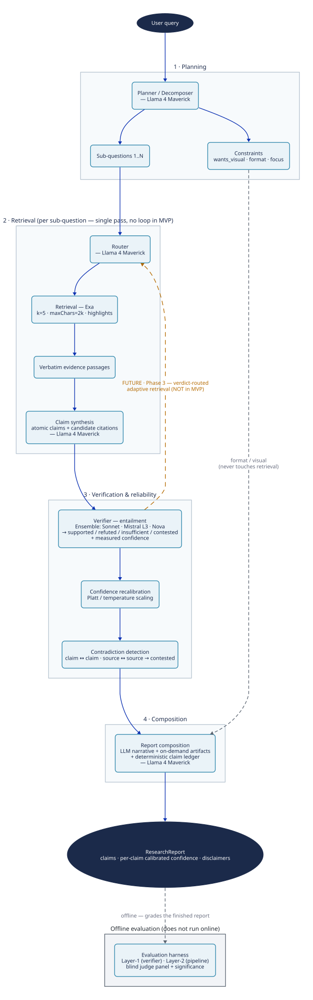

# Deep Research Agent — MVP Architecture (as built)

This document describes the MVP pipeline — what actually runs today, grounded in the components in `src/dra/` and the experiments that settled each choice.

---

## 1. Key components

| Component | Role | Model / tool | Settled by |
|---|---|---|---|
| **Planner / decomposer** | Split the query into 1…N sub-questions and extract presentation **constraints** (`wants_visual`, `format`, `focus`) from the core research query | Llama 4 Maverick | Decomposition ON → 3–4× more unique sources; constraint split keeps formatting out of retrieval |
| **Router** | Route each sub-question to a retrieval tool (academic / web) | Llama 4 Maverick | MVP uses a **single backend (Exa)**; route-by-type is wired but not multi-backend |
| **Retrieval** | Fetch **verbatim** evidence passages (query-targeted highlights, not full text) | Exa · `k=5` · `maxChars=2000` · highlights | Exa won a 12-query bake-off on every axis (recall, relevance, latency) |
| **Claim synthesis** | Turn passages into **atomic claims** + *candidate* citation ids | Llama 4 Maverick | Beat Mistral L3 / Haiku on grounding (1.24) + atomicity; Mistral over-reaches from parametric memory |
| **Verifier (in-loop)** | Entailment check (passage ⊨ claim) → `{supported, refuted, insufficient, contested}` + a **measured** confidence | Ensemble {Sonnet 4.6, Mistral Large 3, Amazon Nova}, majority vote + agreement | Layer-1: v0 matches the 3-model panel (macro-F1 0.839 vs 0.815; AUROC 0.966 vs 0.936) at ~130× lower latency; Layer-2: **v0 selected** as the cheaper drop-in (+0.088 EBM over corrected, quality preserved) |
| **Confidence recalibration** | Map raw confidence → calibrated probability before it is surfaced | Platt / temperature scaling | ECE 0.102 → 0.031 (held-out) |
| **Contradiction detection** | Flag claim↔claim and source↔source conflict → `contested` | In-loop judge, structured-reasoning prompt | "Corrected" prompt fixes Layer-2 over-flagging (quality +0.181, Holm-sig) |
| **Report composition** | Hybrid: LLM narrative + on-demand artifacts (Mermaid / table) + a **deterministic** claim ledger, disclaimers, sources | Llama 4 Maverick + deterministic renderer | Constrain-by-construction: every sentence must cite an existing ledger claim id `[cN]` |
| **Evaluation harness** *(offline)* | Layer-1 (verifier-in-isolation) + Layer-2 (whole-pipeline) scoring; blind judge panel + significance | Panel: GPT-OSS 120B / Opus 4.8 / DeepSeek R1 | Independent of the in-loop verifier; the transparency spine — grades the finished report, does **not** run online |

---

## 2. Architecture diagram

> Rendered from the editable D2 source [`archive/2026-06-14-mvp-architecture.d2`](./archive/2026-06-14-mvp-architecture.d2) with [D2](https://d2lang.com): `d2 --theme 0 --pad 40 archive/2026-06-14-mvp-architecture.d2 mvp-architecture.svg`. D2 (not Mermaid) is used here because it gives true grouped **containers** — the numbered zones — and a layout engine suited to architecture diagrams.

**How to read it.** Solid arrows are the **MVP runtime** — a single forward pass through four zones: **1 Planning** (decompose + extract constraints) → **2 Retrieval** (route → Exa → verbatim passages → claim synthesis, per sub-question) → **3 Verification & reliability** (verify → recalibrate → contradiction) → **4 Composition** (report) → `ResearchReport`. The **grey dashed edge** from Constraints to Composition is the format/modality bypass — formatting never touches retrieval. The **grey dashed edge** to the *Offline evaluation* zone shows the harness grades the finished report; it does **not** run online. The **amber dashed edge** (Verifier → Router) is the **deferred adaptive-retrieval loop** — the verifier already emits the verdicts + confidence that *would* drive it, but in the MVP they are **surfaced, not acted on** (Phase 3).

---

## 3. Key decisions & assumptions

**Decisions (each backed by an experiment / findings doc):**
- **Retrieval = Exa** (`k=5`, `maxChars=2k`, highlights) — won the bake-off; highlights preserve the verbatim-citation invariant.
- **Decomposition ON** — 3–4× more unique sources, with no over-splitting on atomic queries.
- **Generator = Llama 4 Maverick** for decompose / synthesis / composition — best grounding + atomicity; smaller model avoids parametric over-reach.
- **In-loop verifier:** The fine-tuned **DeBERTa-v3 cross-encoder** has now been evaluated to be the most optimal in terms of cost-performance tradeoff. Fine-tuned **verifier v0 is selected** as the ~130× cheaper, calibratable drop-in (matches the panel at Layer-1 — macro-F1 0.839 vs 0.815, AUROC 0.966 vs 0.936; **+0.088 EBM** over corrected at Layer-2 with quality preserved).
- **Contradiction prompt = the corrected (structured-reasoning) variant** — keeps the behavior signal while recovering the quality naïve over-flagging cost.
- **Confidence is recalibrated before it is surfaced** — the report uses the post-Platt value (ECE 0.102 → 0.031).
- **Formatting is a separate component** — the planner splits core-query from constraints so a "include a diagram" instruction can't change the evidence retrieved.

**Assumptions to highlight:**
- **⚠️ The MVP is a single forward pass — there is no adaptive-retrieval loop yet.** The verifier's verdicts and confidence are computed and surfaced, but the system does not yet act on them to search again. The planned extension would replace the fixed retrieval policy with one that decides *when and how* to re-search — routing each sub-question to the best engine and re-querying when the verifier flags weak evidence — reusing the per-claim support signal the verifier already emits as the trigger (so no new reward model is needed). It would directly raise the coverage ceiling, but it cannot beat the absolute search ceiling (if the evidence isn't indexed, smarter search doesn't help), adds latency and cost per question, and needs a stop rule so a naive trigger can't loop until something passes. Designed but not yet built.
- **Future direction — the verifier as a process reward model (PRM).** Beyond the adaptive-retrieval loop, the same calibrated per-claim verifier could become a *dense, per-step* reward signal — scoring intermediate reasoning and search steps (not just final claims) to train a search-again controller with RL. Speculative and not built; contingent on first validating that better evidence reliably raises the verifier's score (and on guarding against reward hacking).
- **Single retrieval backend (Exa)** — cumulative coverage plateaus ~80–85% and is flat beyond `k=5`; multi-backend fusion + route-by-type is future.
- **English, text-only** — no multilingual / multimodal coverage in the MVP.
- **Transparency comes with some over-flagging.** Making per-claim uncertainty explicit means the verifier + contradiction layer still leans toward labelling claims `contested` / `refuted` / `insufficient`. The corrected prompt recovers the *quality* cost of this at Layer-2, but tightening the transparency-vs-over-flagging tradeoff further — fewer spurious flags without losing the behavior signal — is production work, not yet done.
