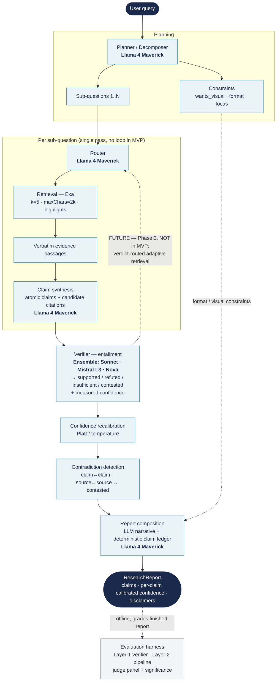

# Deep Research Agent — MVP Architecture (as built)

This document describes the **as-built MVP pipeline** — what actually runs today, grounded in the components in `src/dra/` and the experiments that settled each choice. It deliberately distinguishes the MVP (a **single forward pass**) from the larger design's **adaptive-retrieval loop**, which is **not yet built** (deferred to Phase 3).

---

## 1. Key components

| Component | Role | Model / tool | Settled by |
|---|---|---|---|
| **Planner / decomposer** | Split the query into 1…N sub-questions and extract presentation **constraints** (`wants_visual`, `format`, `focus`) from the core research query | Llama 4 Maverick | Decomposition ON → 3–4× more unique sources; constraint split keeps formatting out of retrieval |
| **Router** | Route each sub-question to a retrieval tool (academic / web) | Llama 4 Maverick | MVP uses a **single backend (Exa)**; route-by-type is wired but not multi-backend |
| **Retrieval** | Fetch **verbatim** evidence passages (query-targeted highlights, not full text) | Exa · `k=5` · `maxChars=2000` · highlights | Exa won a 12-query bake-off on every axis (recall, relevance, latency) |
| **Claim synthesis** | Turn passages into **atomic claims** + *candidate* citation ids | Llama 4 Maverick | Beat Mistral L3 / Haiku on grounding (1.24) + atomicity; Mistral over-reaches from parametric memory |
| **Verifier (in-loop)** | Entailment check (passage ⊨ claim) → `{supported, refuted, insufficient, contested}` + a **measured** confidence | Ensemble {Sonnet 4.6, Mistral Large 3, Amazon Nova}, majority vote + agreement | Layer-1: macro-F1 0.845 (FEVER) / 0.842 (SciFact); **Verifier B** (DeBERTa v0/v1) under evaluation as a ~130× cheaper drop-in |
| **Confidence recalibration** | Map raw confidence → calibrated probability before it is surfaced | Platt / temperature scaling | ECE 0.102 → 0.031 (held-out) |
| **Contradiction detection** | Flag claim↔claim and source↔source conflict → `contested` | In-loop judge, structured-reasoning prompt | "Corrected" prompt fixes Layer-2 over-flagging (quality +0.181, Holm-sig) |
| **Report composition** | Hybrid: LLM narrative + on-demand artifacts (Mermaid / table) + a **deterministic** claim ledger, disclaimers, sources | Llama 4 Maverick + deterministic renderer | Constrain-by-construction: every sentence must cite an existing ledger claim id `[cN]` |
| **Evaluation harness** *(offline)* | Layer-1 (verifier-in-isolation) + Layer-2 (whole-pipeline) scoring; blind judge panel + significance | Panel: GPT-OSS 120B / Opus 4.8 / DeepSeek R1 | Independent of the in-loop verifier; the transparency spine — grades the finished report, does **not** run online |

---

## 2. Architecture diagram

**How to read it.** Solid edges are the **MVP runtime** — a single forward pass: plan → (route → retrieve → synthesize) per sub-question → verify → recalibrate → contradiction → compose. The **dotted edge from constraints to composition** is the format/modality bypass (formatting never touches retrieval). The **offline** dotted edge to the evaluation harness shows it grades the finished report — it does not run online. The **dashed amber edge** (verifier → router) is the **deferred adaptive-retrieval loop** — the verifier already emits the verdicts + confidence that *would* drive it, but in the MVP they are **surfaced, not acted on**.

---

## 3. Key decisions & assumptions

**Decisions (each backed by an experiment / findings doc):**
- **Retrieval = Exa** (`k=5`, `maxChars=2k`, highlights) — won the bake-off; highlights preserve the verbatim-citation invariant. → `2026-06-09-retrieval-engine-decision-exa-vs-tavily.md`
- **Decomposition ON** — 3–4× more unique sources, with no over-splitting on atomic queries. → `2026-06-10-retrieval-experiments-findings.md`
- **Generator = Llama 4 Maverick** for decompose / synthesis / composition — best grounding + atomicity; smaller model avoids parametric over-reach. → `2026-06-10-generator-comparison-findings.md`
- **In-loop verifier = the 3-model ensemble** {Sonnet, Mistral L3, Nova} — confirmed at Layer-1. A fine-tuned **DeBERTa-v3 cross-encoder (v0/v1)** is being evaluated as a ~130× cheaper, calibratable drop-in (Layer-2 in progress). → `2026-06-11-layer1-verifier-eval-findings.md`
- **Contradiction prompt = the corrected (structured-reasoning) variant** — keeps the honesty signal while recovering the quality naïve over-flagging cost. → `2026-06-13-layer2-eval-consolidated-findings.md`
- **Confidence is recalibrated before it is surfaced** — the report uses the post-Platt value (ECE 0.102 → 0.031). → `2026-06-11-calibration.md`
- **Formatting is a separate component** — the planner splits core-query from constraints so a "include a diagram" instruction can't change the evidence retrieved.

**Assumptions to highlight:**
- **⚠️ The MVP is a single forward pass — there is NO adaptive-retrieval loop yet.** The verifier's verdicts/confidence are computed and surfaced, but the system does not (yet) re-route, reformulate, or re-retrieve on `insufficient` / low-confidence. The verdict-routed loop (escalate `k`, widen `maxChars`, reformulate sub-question, switch tool; terminate on `τ | max_iters≈3 | no-progress | budget`) is **designed but deferred to Phase 3**. → `limitations.md` #4; design `2026-06-11-adaptive-retrieval-design.md`.
- **Single retrieval backend (Exa)** — cumulative coverage plateaus ~80–85% and is flat beyond `k=5`; multi-backend fusion + route-by-type is future. → `limitations.md` #5.
- **Model independence is assumed and enforced** — generator ≠ in-loop verifier ≠ judge panel ≠ baseline, via `config.assert_independence()`; biases must not correlate across evaluative boundaries.
- **Evidence is verbatim, never summarized** — verifying a claim against an LLM summary would be circular.
- **English, text-only** — no multilingual / multimodal coverage in the MVP. → `limitations.md` #3.
- **The verifier checks grounding, not source credibility** — a claim can be faithfully grounded in a low-quality source and still pass. → `limitations.md` #2.

---

*Related: full design `docs/superpowers/specs/2026-06-09-deep-research-agent-design.md` (the larger 9-layer architecture incl. guardrails/clarification, which the MVP does not yet implement); results `2026-06-13-layer2-eval-consolidated-findings.md`; verifier comparison `2026-06-11-layer1-verifier-eval-findings.md` §4B.*
