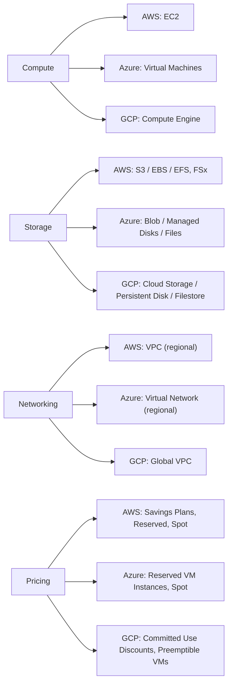

# Research Report
**Query:** Compare the major cloud providers (AWS, Azure, GCP) across compute, storage, networking, and pricing models in a structured table.

## Summary
This report compares the major cloud providers (AWS, Azure, GCP) across compute, storage, networking, and pricing models in a structured table.

## Architecture

## Compute Services
The major cloud providers offer various compute services. AWS offers Elastic Cloud Compute (EC2) [c0], Azure provides Virtual Machines [c1], and GCP offers Compute Engine [c2]. Each service has different instance types, including general purpose, compute optimized, memory optimized, and storage optimized [c3][c4][c5].

## Storage Services
The cloud providers offer object, block, and file storage services. AWS provides S3 (object) [c7], EBS (block) [c10], and EFS/FSx (file) [c13]. Azure offers Blob Storage (object) [c8], Managed Disks (block) [c11], and Azure Files (file) [c14]. GCP provides Cloud Storage (object) [c9], Persistent Disk (block) [c12], and Filestore (file) [c15]. All providers offer storage services with features like versioning and encryption [c16].

## Networking
The providers differ in their virtual network isolation implementations. AWS uses VPCs, Azure uses Virtual Networks, and GCP uses a global VPC model [c18]. GCP's VPC spans across regions, while AWS and Azure have regional VPCs/VNets [c19]. They also differ in their load balancing approaches [c22].

## Pricing Models
The cloud providers use different pricing models. AWS uses pay-as-you-go, Savings Plans, and Reserved Instances [c23]. Azure uses pay-as-you-go and Reserved VM Instances [c24]. GCP uses pay-as-you-go and Committed Use Discounts (CUDs) [c25]. They also offer various pricing options, such as On-Demand, Reserved Instances, and Spot Instances [c26][c27][c28].

## Comparison Table
| Service | AWS | Azure | GCP |
| --- | --- | --- | --- |
| Compute | EC2 [c0] | Virtual Machines [c1] | Compute Engine [c2] |
| Object Storage | S3 [c7] | Blob Storage [c8] | Cloud Storage [c9] |
| Block Storage | EBS [c10] | Managed Disks [c11] | Persistent Disk [c12] |
| File Storage | EFS/FSx [c13] | Azure Files [c14] | Filestore [c15] |
| Virtual Network | VPC [c18] | Virtual Network [c18] | Global VPC [c18] |
| Pricing Model | Pay-as-you-go, Savings Plans, Reserved Instances [c23] | Pay-as-you-go, Reserved VM Instances [c24] | Pay-as-you-go, Committed Use Discounts [c25] |
| Pricing Options | On-Demand, Savings Plans, Reserved Instances, Spot Instances [c26] | On-Demand, Reserved Virtual Machine Instances, Spot Virtual Machines [c27] | On-Demand, Committed Use Discounts, Sustained Use Discounts, Preemptible VMs [c28] |

---

## Detailed Citation Results
| # | Claim | Verdict | Conf | Sources |
|---|---|---|---|---|
| c0 | AWS offers Elastic Cloud Compute (EC2) as its compute service. | supported | 0.81 | https://docs.cloud.google.com/docs/get-started/aws-azure-gcp-service-comparison, https://www.coursera.org/articles/aws-vs-azure-vs-google-cloud, https://www.pluralsight.com/resources/blog/cloud/compute-compared-aws-vs-azure-vs-gcp |
| c1 | Azure provides Virtual Machines as its compute service. | supported | 0.60 | https://azure.microsoft.com/en-us/products/category/compute, https://www.coursera.org/articles/aws-vs-azure-vs-google-cloud, https://www.pluralsight.com/resources/blog/cloud/compute-compared-aws-vs-azure-vs-gcp |
| c2 | GCP offers Compute Engine as its compute service. | insufficient | 0.28 | https://docs.cloud.google.com/docs/get-started/aws-azure-gcp-service-comparison, https://www.coursera.org/articles/aws-vs-azure-vs-google-cloud, https://www.pluralsight.com/resources/blog/cloud/compute-compared-aws-vs-azure-vs-gcp |
| c3 | AWS EC2 offers various instance types, including general purpose, compute optimized, memory optimized, accelerated compute, and storage optimized. | supported | 0.45 | https://www.pluralsight.com/resources/blog/cloud/compute-compared-aws-vs-azure-vs-gcp |
| c4 | GCP Compute Engine supports general purpose VMs, compute optimized, memory optimized, and accelerated VMs, as well as burstable or shared core VMs. | insufficient | 0.25 | https://www.pluralsight.com/resources/blog/cloud/compute-compared-aws-vs-azure-vs-gcp |
| c5 | Azure Virtual Machines offers general purpose VMs, compute and memory optimized VMs, accelerator optimized VMs (GPU type), storage optimized VMs, and burstable options. | supported | 0.66 | https://www.pluralsight.com/resources/blog/cloud/compute-compared-aws-vs-azure-vs-gcp |
| c6 | All three cloud providers (AWS, Azure, GCP) offer auto-scaling capabilities for their compute services. | insufficient | 0.25 | https://azure.microsoft.com/en-us/products/category/compute, https://babulal.com.np/blogs/aws-gcp-azure-services-mapping.html, https://docs.cloud.google.com/docs/get-started/aws-azure-gcp-service-comparison |
| c7 | AWS provides Amazon Simple Storage Service (S3) as its object storage service. | supported | 0.87 | 2296405515, 41430060438, https://babulal.com.np/blogs/aws-gcp-azure-services-mapping.html, https://docs.cloud.google.com/docs/get-started/aws-azure-gcp-service-comparison, https://learn.microsoft.com/en-us/azure/architecture/aws-professional/storage |
| c8 | Azure provides Azure Blob Storage as its object storage service. | supported | 0.87 | 2296405515, 41430060438, https://babulal.com.np/blogs/aws-gcp-azure-services-mapping.html, https://docs.cloud.google.com/docs/get-started/aws-azure-gcp-service-comparison, https://learn.microsoft.com/en-us/azure/architecture/aws-professional/storage |
| c9 | GCP provides Cloud Storage as its object storage service. | supported | 0.75 | 2296405515, 41430060438, https://babulal.com.np/blogs/aws-gcp-azure-services-mapping.html, https://docs.cloud.google.com/docs/get-started/aws-azure-gcp-service-comparison |
| c10 | AWS provides Amazon Elastic Block Store (EBS) as its block storage service. | supported | 0.88 | 2296405515, 41430060438, https://babulal.com.np/blogs/aws-gcp-azure-services-mapping.html, https://docs.cloud.google.com/docs/get-started/aws-azure-gcp-service-comparison, https://learn.microsoft.com/en-us/azure/architecture/aws-professional/storage |
| c11 | Azure provides Managed Disks as its block storage service. | supported | 0.40 | 2296405515, 41430060438, https://babulal.com.np/blogs/aws-gcp-azure-services-mapping.html, https://docs.cloud.google.com/docs/get-started/aws-azure-gcp-service-comparison, https://learn.microsoft.com/en-us/azure/architecture/aws-professional/storage |
| c12 | GCP provides Persistent Disk as its block storage service. | supported | 0.79 | 2296405515, 41430060438, https://babulal.com.np/blogs/aws-gcp-azure-services-mapping.html, https://docs.cloud.google.com/docs/get-started/aws-azure-gcp-service-comparison |
| c13 | AWS provides Amazon Elastic File System (EFS) and FSx as its file storage services. | supported | 0.86 | 2296405515, 41430060438, https://babulal.com.np/blogs/aws-gcp-azure-services-mapping.html, https://docs.cloud.google.com/docs/get-started/aws-azure-gcp-service-comparison |
| c14 | Azure provides Azure Files as its file storage service. | supported | 0.67 | 2296405515, 41430060438, https://babulal.com.np/blogs/aws-gcp-azure-services-mapping.html, https://docs.cloud.google.com/docs/get-started/aws-azure-gcp-service-comparison, https://learn.microsoft.com/en-us/azure/architecture/aws-professional/storage |
| c15 | GCP provides Filestore as its file storage service. | supported | 0.84 | 2296405515, 41430060438, https://babulal.com.np/blogs/aws-gcp-azure-services-mapping.html, https://docs.cloud.google.com/docs/get-started/aws-azure-gcp-service-comparison |
| c16 | All three cloud providers (AWS, Azure, GCP) offer storage services with features like versioning, encryption at rest, and fine-grained security. | insufficient | 0.11 | 2296405515 |
| c17 | AWS, Azure, and GCP offer archive storage tiers with different pricing, such as S3 Glacier, Azure Archive Storage, and Cloud Storage Archive. | supported | 0.60 | 41430060438, https://babulal.com.np/blogs/aws-gcp-azure-services-mapping.html |
| c18 | AWS, Azure, and GCP differ in their virtual network isolation implementations, with AWS using VPCs, Azure using Virtual Networks, and GCP using a global VPC model. | supported | 0.82 | https://www.ituonline.com/blogs/comparing-cloud-networking-solutions-aws-azure-and-gcp/ |
| c19 | GCP's VPC is global and spans across regions, whereas AWS and Azure have regional VPCs/VNets that require explicit peering or transit networking for inter-region connectivity. | supported | 0.87 | https://cloudtoolstack.com/learn/multi-cloud-networking-comparison, https://www.ituonline.com/blogs/comparing-cloud-networking-solutions-aws-azure-and-gcp/ |
| c20 | AWS uses Transit Gateway to simplify multi-VPC communication, Azure uses Virtual WAN for large-scale network management, and GCP uses Shared VPC for efficient resource sharing across projects. | supported | 0.46 | https://www.ituonline.com/blogs/comparing-cloud-networking-solutions-aws-azure-and-gcp/ |
| c21 | The three cloud providers have different default network structures: AWS uses VPCs, subnets, and route tables; Azure starts with subnets, NSGs, and route decisions; GCP's global network abstraction simplifies subnet design but requires careful planning for routing and shared services. | supported | 0.84 | https://www.ituonline.com/blogs/comparing-cloud-networking-solutions-aws-azure-and-gcp/ |
| c22 | GCP's global load balancer uses a single anycast IP address to route users to the nearest healthy backend across regions, differing from AWS and Azure's regional load balancers with separate global routing layers. | supported | 0.77 | https://cloudtoolstack.com/learn/multi-cloud-networking-comparison |
| c23 | AWS uses a pay-as-you-go pricing model, Savings Plans, and Reserved Instances for its services. | supported | 0.71 | https://aws.amazon.com/pricing/, https://docs.aws.amazon.com/pdfs/whitepapers/latest/how-aws-pricing-works/how-aws-pricing-works.pdf?did=wp_card&trk=wp_card, https://www.cloudzero.com/blog/cloud-pricing-comparison/, https://www.usage.ai/blogs/finops/multi-cloud/aws-vs-azure-vs-gcp |
| c24 | Azure uses a pay-as-you-go pricing model and Reserved VM Instances for its services. | supported | 0.65 | https://www.cloudzero.com/blog/cloud-pricing-comparison/, https://www.devzero.io/blog/aws-azure-google-price-comparison, https://www.usage.ai/blogs/finops/multi-cloud/aws-vs-azure-vs-gcp |
| c25 | GCP uses a pay-as-you-go pricing model and Committed Use Discounts (CUDs) for its services. | supported | 0.81 | https://www.cloudzero.com/blog/cloud-pricing-comparison/, https://www.devzero.io/blog/aws-azure-google-price-comparison, https://www.usage.ai/blogs/finops/multi-cloud/aws-vs-azure-vs-gcp |
| c26 | AWS offers On-Demand Instances, Savings Plans, Reserved Instances, and Spot Instances as pricing models. | insufficient | 0.35 | https://aws.amazon.com/pricing/, https://docs.aws.amazon.com/pdfs/whitepapers/latest/how-aws-pricing-works/how-aws-pricing-works.pdf?did=wp_card&trk=wp_card, https://www.cloudzero.com/blog/cloud-pricing-comparison/ |
| c27 | Azure offers On-Demand, Reserved Virtual Machine Instances, and Spot Virtual Machines as pricing models. | insufficient | 0.16 | https://www.cloudzero.com/blog/cloud-pricing-comparison/ |
| c28 | GCP offers On-Demand, Committed Use Discounts, Sustained Use Discounts, and Preemptible VMs as pricing models. | supported | 0.65 | https://www.cloudzero.com/blog/cloud-pricing-comparison/ |

## Confidence & Coverage
- Overall confidence: 0.621   ·   Coverage: 1.0
- Breakdown: supported 23 · insufficient 6

## Disclaimers
- 6 finding(s) have insufficient support and should be treated as tentative.

## Sources
- [https://www.pluralsight.com/resources/blog/cloud/compute-compared-aws-vs-azure-vs-gcp] Compute compared: AWS vs Azure vs GCP | Pluralsight
- [https://docs.cloud.google.com/docs/get-started/aws-azure-gcp-service-comparison] Compare AWS and Azure services to Google Cloud  |  Get started  |  Google Cloud Documentation
- [https://azure.microsoft.com/en-us/products/category/compute] Azure Compute—Virtualization and Scalability | Microsoft Azure
- [https://www.coursera.org/articles/aws-vs-azure-vs-google-cloud] What's the Difference Between AWS vs. Azure vs. Google Cloud? | Coursera
- [https://babulal.com.np/blogs/aws-gcp-azure-services-mapping.html] AWS vs GCP vs Azure — Service-by-Service Mapping — Babulal Tamang
- [2296405515] Storage services compared: AWS vs Azure vs GCP | Pluralsight
- [41430060438] AWS vs Azure vs Google Cloud — comparison guide 2026 | Blog ARDURA Consulting
- [https://learn.microsoft.com/en-us/azure/architecture/aws-professional/storage] Compare Storage Services on Azure and AWS - Azure Architecture Center | Microsoft Learn
- [https://www.ituonline.com/blogs/comparing-cloud-networking-solutions-aws-azure-and-gcp/] Comparing Cloud Networking Solutions: AWS, Azure, and GCP – ITU Online IT Training
- [https://github.com/adstuart/cloud-networking-compared] adstuart/cloud-networking-compared
- [https://www.pluralsight.com/resources/blog/cloud/networking-services-compared-aws-vs-azure-vs-google-cloud] Networking services compared: AWS vs Azure vs Google Cloud | Pluralsight
- [https://cloudtoolstack.com/learn/multi-cloud-networking-comparison] Networking Across Clouds | CloudToolStack
- [https://www.usage.ai/blogs/finops/multi-cloud/aws-vs-azure-vs-gcp] Multi-Cloud Cost Optimization Guide | AWS, Azure, GCP Savings - Usage AI
- [https://aws.amazon.com/pricing/] AWS Product and Service Pricing | Amazon Web Services
- [https://www.cloudzero.com/blog/cloud-pricing-comparison/] 2026 Cloud Pricing Comparison: An In-Depth Guide
- [https://docs.aws.amazon.com/pdfs/whitepapers/latest/how-aws-pricing-works/how-aws-pricing-works.pdf?did=wp_card&trk=wp_card] How AWS Pricing Works - AWS Whitepaper
- [https://www.devzero.io/blog/aws-azure-google-price-comparison] AWS vs Azure vs GCP: Pricing Comparison to Help You Choose | DevZero
