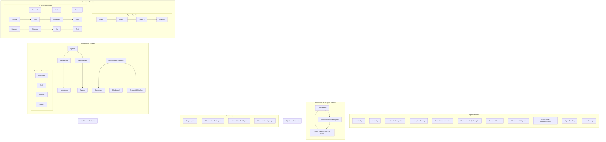

# Research Report
**Query:** Map the research landscape of multi-agent LLM systems. Produce a structured report that includes a visual taxonomy or design graph showing the major architectural patterns, how they relate, and where the open problems are. Include an architecture diagram of the relevant pipeline or process.

## Summary
The research landscape of multi-agent LLM systems encompasses various architectural patterns, configurations, and topologies. Major patterns include centralized and decentralized architectures, with various configurations such as Hierarchical, Swarm, and Hybrid [c0]. Open problems persist in areas like scalability, security, and multimodal integration [c20].

## Architecture

## Architectural Patterns
Multi-agent LLM systems employ several architectural patterns, including [c3][c7]:
- Centralized: Hierarchical patterns with a central supervisor delegating tasks to specialized agents [c1]
- Decentralized: Collaborative patterns with autonomous agents communicating directly in a peer-to-peer fashion [c2]
- Subagents, skills, handoffs, and routers form the foundation of most multi-agent applications [c3]

Other notable patterns include [c8][c34]:
- Supervisor
- Hierarchical
- Swarm
- Blackboard
- Sequential pipeline
- Hybrid

## Taxonomy and Design Graph
A taxonomy of multi-agent LLM systems includes single-agent, collaborative multi-agent, competitive multi-agent, and orchestration topology [c9]. The major architectural patterns relate to each other through their use in different configurations, such as Hybrid patterns [c15].

## Pipeline or Process
A typical pipeline or process for multi-agent LLM systems involves a sequence of agents where each agent receives the previous agent's output as context [c28]. Examples of pipeline patterns include Research → Write → Review, Analyze → Plan → Implement → Verify, and Discover → Diagnose → Fix → Test [c30].

### Architecture Diagram
A production multi-agent system separates concerns across three layers [c32]:
1. Orchestrator: routes and supervises
2. Specialized worker agents: execute tasks
3. Unified memory-and-tool layer: persists state and surfaces external data

The orchestrator receives incoming tasks, decomposes them into subtasks, selects the appropriate worker agent, and monitors completion [c33].

## Open Problems
Open issues in multi-agent LLM systems include [c20]:
- Scalability
- Security
- Multimodal integration
- Managing memory, especially in safety, security, and privacy [c16]
- Implementing robust access control mechanisms [c17]
- Ensuring the integrity of shared knowledge [c18]
- Determining how to effectively recall and utilize contextually relevant past interactions [c19]
- Detecting and mitigating hallucinations [c22]
- Identifying the optimal macro-level communication pattern [c25]
- Automatically profiling and selecting an effective structure for agents [c26]
- Pruning unnecessary links between agents [c27]

These open problems highlight the need for continued research in multi-agent LLM systems.

---

## Detailed Citation Results
| # | Claim | Sources |
|---|---|---|
| c0 | The major architectural patterns in multi-agent LLM systems include centralized and decentralized architectures. | https://resources.anthropic.com/hubfs/Building%20Effective%20AI%20Agents-%20Architecture%20Patterns%20and%20Implementation%20Frameworks.pdf |
| c1 | Centralized systems employ hierarchical patterns where a central supervisor delegates tasks to specialized agents. | https://resources.anthropic.com/hubfs/Building%20Effective%20AI%20Agents-%20Architecture%20Patterns%20and%20Implementation%20Frameworks.pdf |
| c2 | Decentralized systems use collaborative patterns where autonomous agents communicate directly in a peer-to-peer fashion. | https://resources.anthropic.com/hubfs/Building%20Effective%20AI%20Agents-%20Architecture%20Patterns%20and%20Implementation%20Frameworks.pdf |
| c3 | Four architectural patterns form the foundation of most multi-agent applications: subagents, skills, handoffs, and routers. | https://www.langchain.com/blog/choosing-the-right-multi-agent-architecture |
| c4 | Network configurations in multi-agent systems include Supervisor, Swarm, Hierarchical, and Single Information Environment (SIE) architectures. | https://arxiv.org/pdf/2601.03328 |
| c5 | Five primary communication architectures in LLM-based multi-agent systems are: Flat, Hierarchical, Team, Society, and Hybrid architectures. | https://arxiv.org/html/2502.14321 |
| c6 | Topology archetypes for multi-agent LLM systems include Chain, Route, Parallel, Orchestrate, Loop, and Hierarchy structures. | https://arxiv.org/html/2605.13850v2 |
| c7 | The major architectural patterns in multi-agent LLM systems include subagents, skills, handoffs, and routers. | https://www.langchain.com/blog/choosing-the-right-multi-agent-architecture |
| c8 | Other major architectural patterns in multi-agent LLM systems are Supervisor, Hierarchical, Swarm, Blackboard, Sequential pipeline, and Hybrid. | https://www.paiteq.com/blog/multi-agent-orchestration-patterns/ |
| c9 | The patterns can be categorized into a taxonomy that includes single-agent, collaborative multi-agent, competitive multi-agent, and orchestration topology. | https://www.digitalapplied.com/blog/agent-architecture-patterns-taxonomy-2026 |
| c10 | Supervisor-worker and graph topologies are the two multi-agent patterns that are most effective in production. | https://www.digitalapplied.com/blog/agent-architecture-patterns-taxonomy-2026 |
| c11 | Swarm and blackboard patterns are theoretically interesting but rarely outperform hierarchical or graph in practice. | https://www.digitalapplied.com/blog/agent-architecture-patterns-taxonomy-2026 |
| c12 | Most production agent systems are compositions of two or three canonical patterns. | https://www.digitalapplied.com/blog/agent-architecture-patterns-taxonomy-2026 |
| c13 | Hierarchical task decomposition, agent handoff, and supervisor delegation are architectural primitives used in multi-agent frameworks. | https://bayesianpersuasion.com/posts/architectural-primitives-multi-agent-frameworks |
| c14 | Despite the appeal of fully decentralized swarm coordination, every production system that achieves reliability uses some form of centralized orchestration. | https://bayesianpersuasion.com/posts/architectural-primitives-multi-agent-frameworks |
| c15 | The major architectural patterns relate to each other through their use in different configurations, such as Hybrid patterns that combine two or more patterns. | https://www.paiteq.com/blog/multi-agent-orchestration-patterns/ |
| c16 | Managing memory in multi-agent systems is fraught with challenges and open problems, especially in the realms of safety, security, and privacy. | https://arxiv.org/abs/2402.03578 |
| c17 | Implementing robust access control mechanisms is crucial to ensure sensitive information of an agent is not accessible to all agents. | https://arxiv.org/abs/2402.03578 |
| c18 | Ensuring the integrity of shared knowledge is critical to ensure the correct execution of tasks in multi-agent systems. | https://arxiv.org/abs/2402.03578 |
| c19 | Determining how to effectively recall and utilize contextually relevant past interactions among agents for current problem-solving scenarios is an open problem. | https://arxiv.org/abs/2402.03578 |
| c20 | Open issues in multi-agent LLM systems include scalability, security, and multimodal integration. | https://arxiv.org/html/2502.14321 |
| c21 | Functional redundancy among different communication protocols can lead to unnecessary complexity, resource wastage, and increased difficulty in protocol management. | https://arxiv.org/html/2502.14321 |
| c22 | Detecting and mitigating hallucinations in multi-agent LLM systems is a crucial task and presents a unique set of challenges. | https://arxiv.org/html/2402.01680 |
| c23 | The number of agents in a multi-agent system poses a significant challenge from a computational complexity perspective. | https://arxiv.org/html/2402.01680 |
| c24 | Steerability as an RL target is a named open problem. | https://arxiv.org/html/2605.02801 |
| c25 | Identifying the optimal macro-level communication pattern among agents that maximizes task performance while minimizing unnecessary communication overhead is an open problem. | https://arxiv.org/html/2505.22467v1 |
| c26 | Automatically profiling and selecting an effective structure for agents rather than relying on ad-hoc human design is a critical open problem. | https://arxiv.org/html/2505.22467v1 |
| c27 | Pruning unnecessary links between agents while preserving task performance is an open problem. | https://arxiv.org/html/2505.22467v1 |
| c28 | A typical pipeline or process for multi-agent LLM systems involves a sequence of agents where each agent receives the previous agent's output as context. | https://ivern.ai/blog/multi-agent-ai-pipeline-sequential-workflows |
| c29 | The pipeline pattern is suitable for multi-step processes where each step depends on the previous output. | https://ivern.ai/blog/multi-agent-ai-pipeline-sequential-workflows |
| c30 | Examples of pipeline patterns include Research → Write → Review, Analyze → Plan → Implement → Verify, and Discover → Diagnose → Fix → Test. | https://ivern.ai/blog/multi-agent-ai-pipeline-sequential-workflows |
| c31 | In a multi-agent pipeline, each agent specializes in one phase with an optimized system prompt, and the task flows through the agents automatically. | https://ivern.ai/blog/multi-agent-ai-pipeline-sequential-workflows |
| c32 | A production multi-agent system separates concerns across three layers: an orchestrator that routes and supervises, specialized worker agents that execute, and a unified memory-and-tool layer that persists state and surfaces external data. | https://clarion.ai/insights-building-multi-agent-ai-systems-orchestration-memory-tool-use/ |
| c33 | The orchestrator receives incoming tasks, decomposes them into subtasks, selects the appropriate worker agent, and monitors completion. | https://clarion.ai/insights-building-multi-agent-ai-systems-orchestration-memory-tool-use/ |
| c34 | Other common patterns for multi-agent LLM systems include Hierarchical, Parallel (Fan-Out / Fan-In), Pub-Sub (Event-Driven), and Blackboard (Shared Memory). | https://rapidclaw.dev/blog/multi-agent-orchestration-patterns-2026 |
| c35 | The Hierarchical pattern involves a manager agent that decomposes the goal, delegates subtasks to specialist worker agents, reviews their output, and iterates. | https://rapidclaw.dev/blog/multi-agent-orchestration-patterns-2026 |

## Sources
- [https://arxiv.org/pdf/2601.03328] LLM-Enabled Multi-Agent Systems: Empirical Evaluation and Insights into Emerging Design Patterns & Paradigms
- [https://resources.anthropic.com/hubfs/Building%20Effective%20AI%20Agents-%20Architecture%20Patterns%20and%20Implementation%20Frameworks.pdf] Building Effective AI Agents: Architecture Patterns and Implementation Frameworks
- [https://www.langchain.com/blog/choosing-the-right-multi-agent-architecture] Choosing the Right Multi-Agent Architecture
- [https://arxiv.org/html/2502.14321] Beyond Self-Talk: A Communication-Centric Survey of LLM-Based Multi-Agent Systems
- [https://arxiv.org/html/2605.13850v2] A Two-Dimensional Framework for AI Agent Design Patterns: Cognitive Function × Execution Topology
- [https://www.paiteq.com/blog/multi-agent-orchestration-patterns/] Multi-agent system orchestration patterns | Paiteq
- [https://bayesianpersuasion.com/posts/architectural-primitives-multi-agent-frameworks] Architectural Primitives of Multi-Agent Orchestration Frameworks
- [https://www.digitalapplied.com/blog/agent-architecture-patterns-taxonomy-2026] Agent Architecture Patterns: 2026 Taxonomy Guide
- [https://arxiv.org/abs/2402.03578] LLM Multi-Agent Systems: Challenges and Open Problems
- [https://arxiv.org/html/2402.01680] Large Language Model based Multi-Agents: A Survey of Progress and Challenges
- [https://arxiv.org/html/2605.02801] Reinforcement Learning for LLM-based Multi-Agent Systems through Orchestration Traces
- [https://arxiv.org/html/2505.22467v1] Topological Structure Learning Should Be A Research Priority for LLM-Based Multi-Agent Systems
- [https://rapidclaw.dev/blog/multi-agent-orchestration-patterns-2026] Multi-Agent Orchestration [CrewAI + LangGraph] | Rapid Claw
- [https://redis.io/blog/ai-agent-pipeline/] AI agent pipelines: What they are & how they work
- [https://www.inventiple.com/blog/multi-agent-ai-systems-architecture-guide] Multi-Agent AI Systems: Architecture, Orchestration & Production Guide (2026) – Inventiple | Inventiple
- [https://ivern.ai/blog/multi-agent-ai-pipeline-sequential-workflows] Multi-Agent AI Pipeline Tutorial [2026] | Ivern AI
- [https://clarion.ai/insights-building-multi-agent-ai-systems-orchestration-memory-tool-use/] Building Multi-Agent Systems: Orchestration Memory And Tool Use In Production -